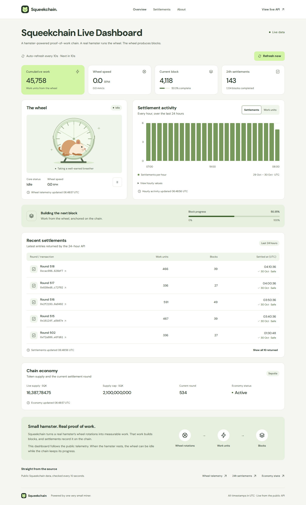

# Squeekchain Live Dashboard

A single-page dashboard for a hamster-powered proof-of-work chain: a real hamster runs on a wheel, generating the work that builds blocks.

The page reads the public Squeekchain APIs directly from your browser. It needs no backend, API key, wallet, or environment file. The complete static production export is included in `dist/` alongside the React + TypeScript source and npm lockfile.



## Run locally

Use Node.js 22.12 or later and npm. Node.js 24 was used for validation.

```sh
npm ci
npm run dev
```

Open the address printed by Vite. To check and rebuild the production site:

```sh
npm run typecheck
npm test
npm run build
npm run preview
```

`npm run preview` serves the production export. You can also serve the existing `dist/` directory with any ordinary static HTTP server without installing dependencies. Opening `index.html` through `file://` is not supported because the application uses browser modules.

Vite is configured with `base: './'`. Scripts, styles, fonts, favicon, and the social card use relative asset URLs. The export works at a static hosting subpath without server rewrites. Navigation uses page anchors. Serve JavaScript, CSS, SVG, PNG, and WOFF2 files with their normal MIME types.

## What it shows

- Cumulative work units and wheel speed in RPM and mm/s.
- Core status: the API's `SPINNING` / `IDLE` values appear as “Spinning” / “Idle”.
- Current anchored block height and block progress, with a native progress bar.
- Settlement count and completed blocks for the API's 24-hour window.
- Hourly settlement or work activity, an expandable table of exact hourly values, and recent settlement transactions.
- Economy state: live supply, supply cap, current round, lifecycle status, and the reported network.

The dashboard fetches all three sources immediately, then every 10 seconds. **Refresh now** starts a new cycle immediately. Requests run concurrently, time out after 8 seconds, and never overlap another cycle. Returning to the browser tab also refreshes the data. Background tabs may throttle timers; the cadence is subject to browser scheduling.

The wheel is an illustration, not a video feed. Its motion follows fresh `SPINNING` telemetry. It stops for idle, stale, or failed telemetry, and honors reduced-motion preferences. The pause button controls the illustration only; it does not pause live updates.

## Public data sources

| Endpoint | Fields used |
| --- | --- |
| [Status](https://api.squeekchain.com/v1/status) | `measurement.cumulativeWorkUnits`, `rpmMilli`, `speedMmPerSecond`, `coreStatus`, `freshness`, `observedAt`, `staleAfterSeconds`; `builder.anchor.blockHeight`, `blockProgress` |
| [24-hour settlements](https://api.squeekchain.com/v1/settlements?range=24h) | `summary.settlementCount`, `completedBlockCount`, `workAdded`, `activeRoundCount`; `buckets`; `recentSettlements`; `chain.chainId`; `window` |
| [Economy state](https://api.squeekchain.com/v1/economy/state) | `asset.symbol`, `asset.decimals`; `supply.liveSupplyBaseUnits`, `capBaseUnits`, `miningMintedBaseUnits`; `lifecycle.currentRound`, `stage`, `paused`; `chain.target` |

All endpoints are CORS enabled. The only external runtime requests needed by the dashboard go to `api.squeekchain.com`; fonts and graphics are bundled locally. Etherscan links open only when selected, and use the chain ID returned by the API. The observed API network during validation was **Sepolia**, not Ethereum mainnet. Unknown networks display transaction hashes without guessing an explorer.

Conversions are implemented in `src/data.ts`:

- RPM = `rpmMilli / 1000`.
- Progress as a fraction = `blockProgress / 1e9`; displayed percent = that fraction × 100. The summary rounds to one decimal; the detailed meter shows two.
- Settlement totals come from `summary.settlementCount`, not the length of the limited recent list. The API determines the window and hourly buckets; the dashboard does not invent missing hours or transactions.
- Large integer counters use `BigInt` for formatting. Token balances use the API's decimals with integer arithmetic and are truncated to two displayed decimal places; the cap is shown in whole tokens.
- Data timestamps and source receipt times are shown in UTC. “Updated” means the browser received that source successfully. Sensor age is separately checked against `observedAt` and `staleAfterSeconds`.

## Loading, outages, and accessibility

Initial loading and missing values are labeled; there are no seeded or simulated live readings. A failed source retains its last successful values, shows an error beside its section and in the dashboard status, and retries automatically. Sources recover independently. With no prior response the value reads “Unavailable”. No data is persisted between visits.

The page includes a skip link, native controls, visible keyboard focus, explicit status text, labels for changing values, an accessible hourly table, a pause control, and reduced-motion support. The product, refresh action, and four summary metrics are visible on the first screen at 390 × 844. [Design documentation](DESIGN.md) describes the implemented system.

## Validation

The final source was validated in an isolated temporary dependency workspace, leaving no `node_modules` or package cache in the submission. The checked production export is the one included here.

| Check | Actual result |
| --- | --- |
| `npm run typecheck` | Passed |
| `npm test` | 6 tests passed |
| `npm run build` | Passed; complete static export generated |
| `npm run test:browser -- --project=chromium` | 8 tests passed, including refresh, retry, partial failure, timeout, idle transitions, chart/table controls, reflow, and an axe accessibility scan |
| Pinned `taste.mjs --out test/scratch/taste` | 16/16 checks passed |
| Real browser requests | All three public APIs returned HTTP 200; repeated polling and manual refresh observed |

For browser tests on another machine:

```sh
npx playwright install chromium
npm run build
npm run test:browser -- --project=chromium
```

The suite also defines a WebKit project. To run it where the OS dependencies are available, install WebKit with `npx playwright install webkit` and run `npm run test:browser -- --project=webkit`.

**Limits:** WebKit could not launch in this environment because required OS libraries were missing. Physical devices, screen readers, browser-native zoom, and social-platform link crawlers were not tested. The 200% check enlarged the root text size; it was not native browser zoom. API availability and upstream schema changes remain external dependencies. The social image uses a relative URL because a final public origin has not yet been assigned.

See [the full validation record](artifacts/validation.md), [measured design checks](artifacts/design-probe.json), and [the mobile first screen](artifacts/dashboard-mobile.png).

## Files and delivery

```text
src/                    React UI, API parsing, refresh logic, styles, SVG artwork
public/                 Favicon, PNG/SVG social card, runtime license notices
dist/                   Finished static website; serve this directory
tests/                  Parser and browser interaction tests; test-only fixtures
artifacts/              Validation, design probe results, screenshots, guide licenses
DESIGN.md               Final tokens, typography, components, responsive behavior
package.json            Scripts and dependencies
package-lock.json       Reproducible dependency resolution
```

The test server is validation tooling, not an application backend. Test fixtures are never imported into the production app. The site does not use a service worker, database, account, RPC, or wallet connector.

The `.gitignore` has an explicit **zero-byte submission budget** for dependency/cache directories and browser-tool scratch output at every nesting level, coverage, TypeScript build caches, and `test/scratch/`. `dist/` and `artifacts/` are deliberately included, with respective budgets of 1 MiB and 5 MiB; all remaining deliverables share 2 MiB. The complete added-file bundle must stay below **8,388,608 bytes**; the measured result is recorded in the validation report. No vendored registry, dependency archives, or submodules are required.

The source and static export are prepared for the IdentityMD submission bundle. The public GitHub repository URL, deployed website URL, and job page URL are assigned or exposed by the surrounding publication/job system after submission; they were not provided in this workspace. No public deployment or repository creation is claimed here, and no guessed links are included.

## Attribution

The hamster, wheel, favicon, and social card are original SVG artwork for this dashboard. DM Sans is bundled under the SIL Open Font License. React is MIT licensed. See [third-party notices](THIRD_PARTY_NOTICES.md). Design and review used the pinned Better Interface and design-critic references; attribution and their included guidance licenses are retained.
